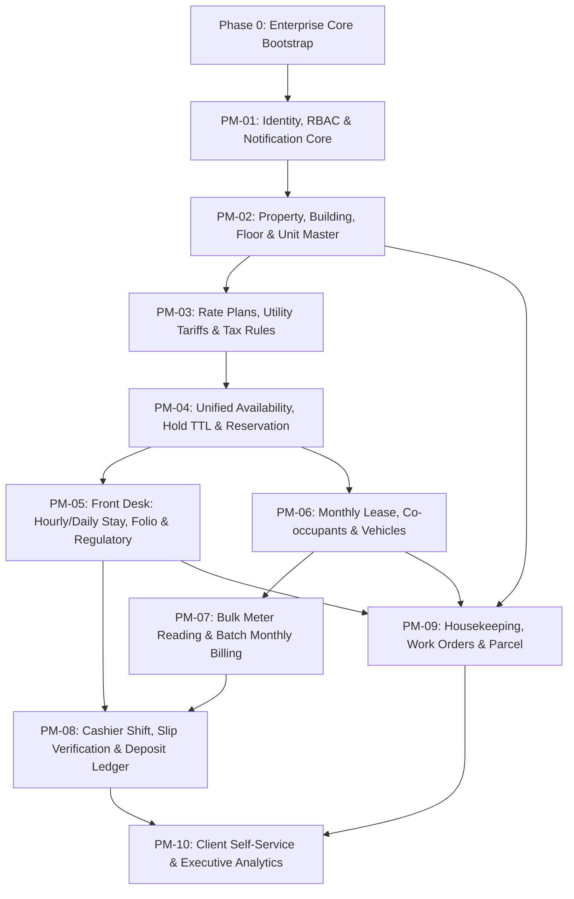

# Implementation Roadmap — `tan-pms` (`PM-01` – `PM-10`)

เอกสารนี้กำหนดลำดับการพัฒนาโปรเจกต์ **`tan-pms`** แบ่งเป็น **Phase 0 (Enterprise Core Bootstrap)** และ **10 Vertical Slices (`PM-01` ถึง `PM-10`)** พร้อมความสัมพันธ์ระหว่างโมดูลและหลักฐานการตรวจสอบ (Verification Evidence)

> อ้างอิงเกณฑ์ความพร้อมก่อนเริ่มโค้ดจาก [development-ready-gate.md](../05-engineering/development-ready-gate.md) และเกณฑ์ส่งมอบงานจาก [definition-of-done.md](../05-engineering/definition-of-done.md)

---

## 1. แผนภาพลำดับการพัฒนา (Dependency Graph)

---

## 2. ตารางแผนงานและเกณฑ์ตรวจสอบรายโมดูล (`Phase 0` & `PM-01` – `PM-10`)

| ลำดับ / รหัส | ชื่อโมดูล (Vertical Slice) | ขอบเขตงานหลัก (Key Deliverables) | ต้องพึ่งพา (Depends On) | เกณฑ์ผ่านและหลักฐานการทดสอบ (Verification Gate) |
|---|---|---|---|---|
| **Phase 0** | **Enterprise Core Bootstrap** | โครงสร้าง `.NET 10` 4 ชั้น, `Next.js` (`(auth)`, `(admin)`, `(client)`), `EF Core 10` + `Dapper`, Audit/Soft-Delete Interceptor, RFC 9457 Problem Details, `DocumentNumberService`, `IFileStorage`, Ollama UI Primitives | เอกสาร Governance ทั้งหมด | ผ่าน `ArchUnitNET`, Concurrency Test รันเลขเอกสาร 100 รายการพร้อมกันไม่ซ้ำ, และ `npm run verify:docs` |
| **`PM-01`** | **Foundation, Identity, Multi-Property RBAC & Notification Core** | ระบบล็อกอินแยก `AdminScope` (`AllowedPropertyIds` + Permissions) และ `ClientScope` (`CustomerId`), จัดการบทบาท/สิทธิ์, `INotificationSender` (In-App + LINE/Email Adapter) | Phase 0 | Integration Test ยืนยันว่าพนักงานสาขา A เข้าถึงข้อมูลสาขา B ไม่ได้ (`403`/`404`) และ `client` ข้าม `CustomerId` ไม่ได้ |
| **`PM-02`** | **Property, Building, Floor, UnitType & Unit Master** | CRUD สาขา (`Property`), อาคาร (`Building`), ชั้น (`Floor`), ประเภทห้อง (`UnitType`), ห้องพัก (`Unit`), ตั้งค่า `SupportedStayModes` และทะเบียนทรัพย์สินประจำห้อง (`UnitAsset`) | `PM-01` | ทดสอบการสร้างผังตึก-ชั้น-ห้อง, การตั้งค่าโหมดเข้าพัก และการแสดงผลผังห้องตาม `PropertyId` |
| **`PM-03`** | **Rate Plans, Hourly Packages, Utility Tariffs & Tax Rules** | กฎราคารายชั่วโมง (`HourlyRateRule`: แพ็กเกจเริ่มต้น, ชั่วโมงถัดไป, `GracePeriodMinutes`, `AutoCapToDailyRate`, `TurnaroundBufferMinutes`), กฎราคารายวัน, อัตราค่าน้ำ-ไฟ และ `TaxProfile` (`Exempt`, `VatIncluded`, `VatExcluded`, `WithholdingTax`) | `PM-02` | Unit Test ครอบคลุมสูตรคำนวณราคารายชั่วโมง/ปัดเป็นรายวัน, สูตรมิเตอร์น้ำ-ไฟ และการคำนวณภาษีรายบรรทัดครบทุกกรณี |
| **`PM-04`** | **Unified Availability Engine, Booking Hold (TTL) & Reservation** | ตารางห้องว่างรวม 3 โหมด (`Unified Room Rack`), การจองแบบโควตา `UnitType` และระบุเลข `Unit`, กลไกล็อกห้องชั่วคราว `Hold` (`HoldExpiresAt` 15 นาที) และ `EXCLUDE USING gist` บน `tstzrange` | `PM-03` | Integration Test ยิงจองพร้อมกัน (Concurrency) ยืนยันว่าไม่เกิด Double-Booking และใบจอง `Hold` ที่หมดเวลาคืนโควตาอัตโนมัติ |
| **`PM-05`** | **Front Desk: Hourly & Daily Stay, Guest Folio & Regulatory Export** | เปิดห้องด่วน (`Quick Walk-in`), ตัวจับเวลาห้องรายชั่วโมง, การต่อเวลา, บัญชีค่าใช้จ่ายประจำห้อง (`Folio`), การบล็อกเปิดห้อง `Dirty` และรายงาน ร.ร.4 / ตม.30 (TM.30) | `PM-04` | ทดสอบ Flow `CheckIn` -> เพิ่มรายการ `Folio` -> `CheckOut` -> เปลี่ยนห้องเป็น `Dirty` พร้อมสร้างงานแม่บ้านอัตโนมัติ |
| **`PM-06`** | **Monthly Lease Lifecycle, Co-occupants & Vehicle Registry** | สัญญาเช่ารายเดือน (`Lease` + PDF), บันทึกส่งมอบห้องและเลขมิเตอร์ตั้งต้น, ทะเบียนผู้พักร่วม (`Occupant`) และป้ายทะเบียนรถ, การต่อสัญญา/ย้ายห้อง/แจ้งย้ายออก และคำนวณคืนเงินประกัน | `PM-04` | ทดสอบว่าห้องที่มี `Lease = Active` ถูกบล็อกไม่ให้เปิด `Hourly`/`Daily` และค้นหาห้องจากป้ายทะเบียนรถได้ถูกต้อง |
| **`PM-07`** | **Bulk Utility Meter Reading & Batch Monthly Billing** | ตารางจดมิเตอร์น้ำ-ไฟยกตึก (`MeterReading`) แบบ Zero-Layout-Shift, ดักจับ `MeterRollover` / หน่วยพุ่งผิดปกติ, และการสร้างใบแจ้งหนี้รายเดือนยกตึก (`Batch Invoice Run`) | `PM-06` | ทดสอบการคำนวณมิเตอร์ครบรอบ (`Rollover`), การสร้าง `Invoice` สถานะ `Draft` ยกตึก และการกด `Issue` พร้อมส่งแจ้งเตือน |
| **`PM-08`** | **Cashier Shift, Payment Slip Verification & Deposit Ledger** | ระบบเปิด-ปิดกะแคชเชียร์ (`CashierShift`: `Open` -> `Closed` -> `Reconciled`), คิวตรวจสลิปโอนเงิน (`Maker-Checker` ออก `Receipt` PDF อัตโนมัติ) และทะเบียนคุมเงินมัดจำ/เงินประกัน (`DepositLedger`) | `PM-05`, `PM-07` | ทดสอบการห้ามรับเงินสดเมื่อยังไม่เปิดกะ, การกระทบยอดเงินสดปิดกะ (`CashVariance`) และการแยกบัญชี `DepositLedger` ออกจากรายได้ |
| **`PM-09`** | **Housekeeping, Maintenance Work Orders & Parcel Management** | กระดานงานแม่บ้าน (`HousekeepingTask`), ระบบใบแจ้งซ่อม (`WorkOrder` พร้อมส่งค่าซ่อมเข้า `Folio`/`Invoice`) และระบบรับ-ส่งมอบพัสดุผู้เช่า (`Parcel`) | `PM-02`, `PM-05`, `PM-06` | ทดสอบการเปลี่ยนสถานะห้อง `Dirty` -> `Clean`, การโอนค่าซ่อมเข้าบิลผู้เช่า และการแจ้งเตือนพัสดุไปยังฝั่ง `client` |
| **`PM-10`** | **Client Self-Service Experience & Executive Analytics** | หน้าเว็บฝั่ง `client` (`/client/...` จองห้องออนไลน์พร้อม Countdown `Hold TTL`, ดูสัญญา/บิล/กราฟน้ำไฟ, แนบสลิป, แจ้งซ่อม, ดูพัสดุ) และหน้าวิเคราะห์ผู้บริหาร (`/admin/analytics`: Occupancy, RevPAR, Aging) | `PM-08`, `PM-09` | E2E Test (`Playwright`) ครบวงจรตั้งแต่ `client` จอง/แนบสลิป จนถึง `admin` อนุมัติและดูผลในรายงานผู้บริหาร |
