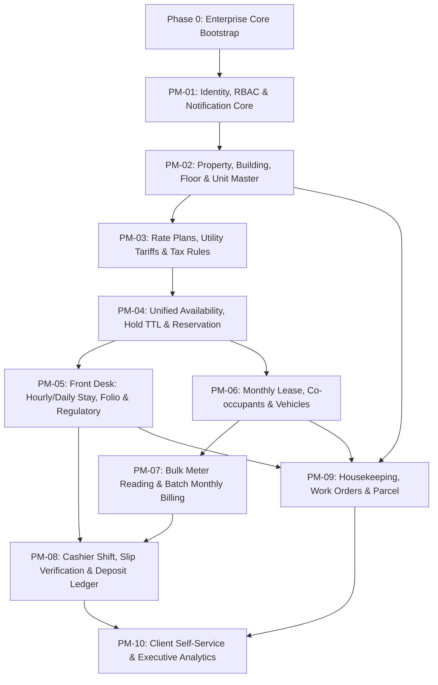

# Implementation Roadmap — `tan-pms` (`PM-01` – `PM-10`)

เอกสารนี้กำหนดลำดับการพัฒนาโปรเจกต์ **`tan-pms`** แบ่งเป็น **Phase 0 (Enterprise Core Bootstrap)** และ **10 Vertical Slices (`PM-01` ถึง `PM-10`)** พร้อมความสัมพันธ์ระหว่างโมดูลและหลักฐานการตรวจสอบ (Verification Evidence)

> อ้างอิงเกณฑ์ความพร้อมก่อนเริ่มโค้ดจาก [development-ready-gate.md](../05-engineering/development-ready-gate.md) และเกณฑ์ส่งมอบงานจาก [definition-of-done.md](../05-engineering/definition-of-done.md)

---

## 1. แผนภาพลำดับการพัฒนา (Dependency Graph)

---

## 2. ตารางแผนงานและเกณฑ์ตรวจสอบรายโมดูล (`Phase 0` & `PM-01` – `PM-10`)

| ลำดับ / รหัส | ชื่อโมดูล (Vertical Slice) | ขอบเขตงานหลัก (Key Deliverables) | ต้องพึ่งพา (Depends On) | เกณฑ์ผ่านและหลักฐานการทดสอบ (Verification Gate) |
|---|---|---|---|---|
| **Phase 0** | **Enterprise Core Bootstrap** | โครงสร้าง `.NET 10` 4 ชั้น, `Next.js` (`(auth)`, `(admin)`, `(client)`), `EF Core 10` + `Dapper`, Audit/Soft-Delete Interceptor, RFC 9457 Problem Details, `DocumentNumberService`, `IFileStorage`, Ollama UI Primitives | เอกสาร Governance ทั้งหมด | ผ่าน `ArchUnitNET`, Concurrency Test รันเลขเอกสาร 100 รายการพร้อมกันไม่ซ้ำ, และ `npm run verify:docs` |
| **`PM-01`** | **Foundation, Identity, Multi-Property RBAC & Notification Core** | ระบบล็อกอินแยก `AdminScope` (`AllowedPropertyIds` + Permissions) และ `ClientScope` (`CustomerId`), จัดการบทบาท/สิทธิ์, `INotificationSender` (In-App + LINE/Email Adapter) | Phase 0 | Integration Test ยืนยันว่าพนักงานสาขา A เข้าถึงข้อมูลสาขา B ไม่ได้ (`403`/`404`) และ `client` ข้าม `CustomerId` ไม่ได้ |
| **`PM-02`** | **Property, Building, Floor, UnitType & Unit Master** | CRUD สาขา (`Property`), อาคาร (`Building`), ชั้น (`Floor`), ประเภทห้อง (`UnitType`), ห้องพัก (`Unit`), ตั้งค่า `SupportedStayModes` และทะเบียนทรัพย์สินประจำห้อง (`UnitAsset`) | `PM-01` | ทดสอบการสร้างผังตึก-ชั้น-ห้อง, การตั้งค่าโหมดเข้าพัก และการแสดงผลผังห้องตาม `PropertyId` |
| **`PM-03`** | **Rate Plans, Hourly Packages, Utility Tariffs & Tax Rules** | กฎราคารายชั่วโมง (`HourlyRateRule`: แพ็กเกจเริ่มต้น, ชั่วโมงถัดไป, `GracePeriodMinutes`, `AutoCapToDailyRate`, `TurnaroundBufferMinutes`), กฎราคารายวัน, อัตราค่าน้ำ-ไฟ และ `TaxProfile` (`Exempt`, `VatIncluded`, `VatExcluded`, `WithholdingTax`) | `PM-02` | Unit Test ครอบคลุมสูตรคำนวณราคารายชั่วโมง/ปัดเป็นรายวัน, สูตรมิเตอร์น้ำ-ไฟ และการคำนวณภาษีรายบรรทัดครบทุกกรณี |
| **`PM-04`** | **Unified Availability Engine, Booking Hold (TTL) & Reservation** | ตารางห้องว่างรวม 3 โหมด (`Unified Room Rack`), การจองแบบโควตา `UnitType` และระบุเลข `Unit`, กลไกล็อกห้องชั่วคราว `Hold` (`HoldExpiresAt` 15 นาที) และ `EXCLUDE USING gist` บน `tstzrange` | `PM-03` | Integration Test ยิงจองพร้อมกัน (Concurrency) ยืนยันว่าไม่เกิด Double-Booking และใบจอง `Hold` ที่หมดเวลาคืนโควตาอัตโนมัติ |
| **`PM-05`** | **Front Desk: Hourly & Daily Stay, Guest Folio & Regulatory Export** | เปิดห้องด่วน (`Quick Walk-in`), ตัวจับเวลาห้องรายชั่วโมง, การต่อเวลา, บัญชีค่าใช้จ่ายประจำห้อง (`Folio`), การบล็อกเปิดห้อง `Dirty` และรายงาน ร.ร.4 / ตม.30 (TM.30) | `PM-04` | ทดสอบ Flow `CheckIn` -> เพิ่มรายการ `Folio` -> `CheckOut` -> เปลี่ยนห้องเป็น `Dirty` พร้อมสร้างงานแม่บ้านอัตโนมัติ |
| **`PM-06`** | **Monthly Lease Lifecycle, Co-occupants & Vehicle Registry** | สัญญาเช่ารายเดือน (`Lease` + PDF), บันทึกส่งมอบห้องและเลขมิเตอร์ตั้งต้น, ทะเบียนผู้พักร่วม (`Occupant`) และป้ายทะเบียนรถ, การต่อสัญญา/ย้ายห้อง/แจ้งย้ายออก และคำนวณคืนเงินประกัน | `PM-04` | ทดสอบว่าห้องที่มี `Lease = Active` ถูกบล็อกไม่ให้เปิด `Hourly`/`Daily` และค้นหาห้องจากป้ายทะเบียนรถได้ถูกต้อง |
| **`PM-07`** | **Bulk Utility Meter Reading & Batch Monthly Billing** | ตารางจดมิเตอร์น้ำ-ไฟยกตึก (`MeterReading`) แบบ Zero-Layout-Shift, ดักจับ `MeterRollover` / หน่วยพุ่งผิดปกติ, และการสร้างใบแจ้งหนี้รายเดือนยกตึก (`Batch Invoice Run`) | `PM-06` | ทดสอบการคำนวณมิเตอร์ครบรอบ (`Rollover`), การสร้าง `Invoice` สถานะ `Draft` ยกตึก และการกด `Issue` พร้อมส่งแจ้งเตือน |
| **`PM-08`** | **Cashier Shift, Payment Slip Verification & Deposit Ledger** | ระบบเปิด-ปิดกะแคชเชียร์ (`CashierShift`: `Open` -> `Closed` -> `Reconciled`), คิวตรวจสลิปโอนเงิน (`Maker-Checker` ออก `Receipt` PDF อัตโนมัติ) และทะเบียนคุมเงินมัดจำ/เงินประกัน (`DepositLedger`) | `PM-05`, `PM-07` | ทดสอบการห้ามรับเงินสดเมื่อยังไม่เปิดกะ, การกระทบยอดเงินสดปิดกะ (`CashVariance`) และการแยกบัญชี `DepositLedger` ออกจากรายได้ |
| **`PM-09`** | **Housekeeping, Maintenance Work Orders & Parcel Management** | กระดานงานแม่บ้าน (`HousekeepingTask`), ระบบใบแจ้งซ่อม (`WorkOrder` พร้อมส่งค่าซ่อมเข้า `Folio`/`Invoice`) และระบบรับ-ส่งมอบพัสดุผู้เช่า (`Parcel`) | `PM-02`, `PM-05`, `PM-06` | ทดสอบการเปลี่ยนสถานะห้อง `Dirty` -> `Clean`, การโอนค่าซ่อมเข้าบิลผู้เช่า และการแจ้งเตือนพัสดุไปยังฝั่ง `client` |
| **`PM-10`** | **Client Self-Service Experience & Executive Analytics** | หน้าเว็บฝั่ง `client` (`/client/...` จองห้องออนไลน์พร้อม Countdown `Hold TTL`, ดูสัญญา/บิล/กราฟน้ำไฟ, แนบสลิป, แจ้งซ่อม, ดูพัสดุ) และหน้าวิเคราะห์ผู้บริหาร (`/admin/analytics`: Occupancy, RevPAR, Aging) | `PM-08`, `PM-09` | E2E Test (`Playwright`) ครบวงจรตั้งแต่ `client` จอง/แนบสลิป จนถึง `admin` อนุมัติและดูผลในรายงานผู้บริหาร |

---

## 3. สถานะการพัฒนา (Implementation Status)

> **อัปเดตล่าสุด:** 2026-11-11 (จากการตรวจโค้ดและชื่อไฟล์ทดสอบ/Migration จริงใน Repository) เอกสารนี้เป็นแหล่งหลักของสถานะ Implementation ตามที่ [AGENTS.md](../../AGENTS.md) กำหนด

**ความหมายของสถานะ (อ้างอิง [development-ready-gate.md](../05-engineering/development-ready-gate.md) และ [definition-of-done.md](../05-engineering/definition-of-done.md)):**

| สถานะ | ความหมาย |
|---|---|
| **Implemented** | มีโค้ด Backend (`TanPms.Domain`/`Application`/`Infrastructure`/`WebApi`), สัญญา OpenAPI และหน้าจอ Frontend ครบตามขอบเขตของ Slice |
| **Tests exist** | มีชุดทดสอบ Unit/Integration (`backend/tests`) และ Vitest (`frontend/src/__tests__`) อ้างอิง Slice นั้น — **ผลผ่านล่าสุดต้องยืนยันด้วยการรัน Gate เต็มตาม [AGENTS.md](../../AGENTS.md) หมวด 8** (การอัปเดตเอกสารรอบนี้ไม่ได้รันชุดทดสอบ) |
| **Not UAT / Not production-ready** | ยังไม่ผ่าน UAT, ยังไม่ผ่านเกณฑ์ Production ตาม Development-Ready Gate และ Definition of Done ทุก Slice อยู่ในสถานะนี้ |

### 3.1 สถานะรายโมดูล

| รหัส | Implemented | Tests exist | UAT / Production-ready | หลักฐานอ้างอิง (Evidence Pointer) |
|---|---|---|---|---|
| **Phase 0** | ใช่ (4 ชั้น, EF Core + Dapper, Audit/Soft-Delete, Problem Details, `DocumentSequence`, `IFileStorage`, Ollama UI Primitives) | มี | ยัง | Backend: `TanPms.ArchitectureTests/CleanArchitectureTests.cs`, `TanPms.UnitTests/{LocalizedTextTests,PersistenceModelTests,DbContextModelCreationTests}.cs`, `TanPms.IntegrationTests/PostgresPersistenceIntegrationTests.cs`; Frontend: `foundation-suite.test.tsx`, `code-hygiene.test.ts`, `i18n-parity.test.ts`, `problem-details.test.ts`, `localized-text.test.ts`, `data-table-preserved.test.tsx`, `form-tabs.test.tsx`, `deferred-file-upload.test.ts`; Migration: `20261106183321_InitialCreate`, `20261107044619_AddDocumentSequencesAndSlotExclusionConstraints` |
| **`PM-01`** | บางส่วน: ผู้ใช้/บทบาท/สิทธิ์/Notification (`InApp`) ทำงาน; **การยืนยันตัวตนจริงยังไม่เสร็จ (อยู่ระหว่างพัฒนา)** | มี | ยัง | `UnitTests/IdentityAndNotificationDomainTests.cs`, `IntegrationTests/WebApiContractAndScopeTests.cs`, `pm01-rbac-notifications.test.tsx`, `pm01-05-crud-wired.test.tsx` |
| **`PM-02`** | ใช่ (รวม Master Data CRUD และ Soft Delete ตาม [ADR-0010](../adr/0010-delete-cancel-void-policy.md)) | มี | ยัง | `UnitTests/{PropertyHierarchyAndUnitMasterTests,MasterDataAndStayLifecycleTests}.cs`, `IntegrationTests/MasterDataAndStayWebTests.cs`, `pm02-unit-master.test.tsx`; Migration `20261110055232_AddMasterDataAndStayEditColumns` |
| **`PM-03`** | ใช่ (รวมตัวจำลองราคา Rate Simulator) | มี | ยัง | `UnitTests/{RatePlansTariffsAndTaxProfilesTests,DomainRulesAndCalculatorsTests}.cs`, `pm03-rates-tariffs-tax.test.tsx`, `pm03-04-simulator-inspector.test.tsx` |
| **`PM-04`** | ใช่ (Hold TTL, `tstzrange` + `EXCLUDE USING gist`, Availability Inspector) | มี (Concurrency บน PostgreSQL จริงผ่าน Testcontainers ต้องมี Docker) | ยัง | `UnitTests/UnifiedAvailabilityAndReservationTests.cs`, `IntegrationTests/PostgresPersistenceIntegrationTests.cs`, `pm04-availability-reservations.test.tsx`, `pm04-05-crud-wired.test.tsx`; Migration `20261107044619_...SlotExclusionConstraints` |
| **`PM-05`** | ใช่ (Check-in/Out, Folio, ตรวจกะเปิดระดับสาขา [ADR-0009](../adr/0009-cash-binding-to-cashier-shift.md), รายงาน ร.ร.4/ตม.30) | มี | ยัง | `UnitTests/FrontDeskStayFolioAndRegulatoryTests.cs`, `pm05-stays-folio-regulatory.test.tsx`, `pm05-checkin-wired.test.tsx` |
| **`PM-06`** | ใช่ (`Lease`, ผู้พักร่วม, รถ, ต่อสัญญา/ย้ายออก/คืนประกัน, PDF สัญญา [ADR-0006](../adr/0006-pdf-generation-questpdf-sarabun.md)) | มี | ยัง | `UnitTests/{MonthlyLeaseLifecycleTests,FilesPdfAndCashBindingTests}.cs`, `pm06-monthly-leases.test.tsx`, `pm-files-pdf-names.test.tsx` |
| **`PM-07`** | ใช่ (จดมิเตอร์ยกตึก, Batch Invoice, `DueDate`/Payment Terms, Overdue Sweeper [ADR-0008](../adr/0008-invoice-due-date-payment-terms-and-overdue-sweeper.md)) | มี | ยัง | `UnitTests/{MeterReadingAndBatchBillingTests,DueDatesPagingAndReceiptsTests}.cs`, `IntegrationTests/PagingAndBillingSettingsWebTests.cs`, `pm07-meters-billing.test.tsx`, `pm-f4-duedate-pagination-methods.test.tsx`; Migration `20261107171123_AddInvoiceBillingPeriodAndMeterReadingUniqueness`, `20261110094601_AddDueDatesReceiptsForStaysAndPaymentMethods` |
| **`PM-08`** | ใช่ (`CashierShift` ผูกเงินสดจริง, Maker-Checker สลิป, `DepositLedger`, ใบเสร็จรวมใบเสร็จจากการชำระ `Folio`) | มี | ยัง | `UnitTests/{CashierShiftSlipAndDepositTests,FilesPdfAndCashBindingTests}.cs`, `pm08-cashier-payments-deposits.test.tsx`; Migration `20261107172909_AddCashierShiftUniquenessAndPaymentSlips` |
| **`PM-09`** | ใช่ (งานแม่บ้าน, `WorkOrder`, `Parcel`) | มี | ยัง | `UnitTests/HousekeepingWorkOrderAndParcelTests.cs`, `pm09-operations.test.tsx`; Migration `20261108001459_AddWorkOrderLifecycleAndParcelPickup` |
| **`PM-10`** | ใช่ (Client Portal API/หน้าจอ, `LeaseIntent`, Analytics: Occupancy, RevPAR, Aging, กะ, เงินมัดจำ) | มี | ยัง; **ไม่มี E2E (`Playwright`) ตามเกณฑ์ของ Slice** | `UnitTests/ClientSelfServiceAndAnalyticsTests.cs`, `IntegrationTests/{ClientSelfServiceAndAnalyticsWebTests,AnalyticsParityPostgresTests}.cs`, `pm10-client-portal.test.tsx`, `pm10-admin-analytics-intents.test.tsx`; Migration `20261108135523_AddLeaseIntentsAndAnalyticsColumns` |
| **ข้ามโมดูล** | CRUD ครบวงจร, ไฟล์แนบ ([ADR-0005](../adr/0005-authorized-file-storage-stored-file.md)), Pagination ([ADR-0007](../adr/0007-server-side-pagination-contract.md)), Cancel/Void ([ADR-0010](../adr/0010-delete-cancel-void-policy.md)) | มี | ยัง | `UnitTests/CrudLifecycleGapTests.cs`, `pm-crud-completeness.test.tsx`; Migration `20261108004611_AddCrudLifecycleColumns`, `20261108133926_AddStoredFilesAndCancelReasons` |

> ชื่อไฟล์ทดสอบ Backend อยู่ใต้ `backend/tests/` (`TanPms.UnitTests`, `TanPms.IntegrationTests`, `TanPms.ArchitectureTests`), ชื่อไฟล์ Frontend อยู่ใต้ `frontend/src/__tests__/`, Migration อยู่ใต้ `backend/src/TanPms.Infrastructure/Persistence/Migrations/`

### 3.2 สิ่งที่ยังไม่ได้ทำ (Explicitly NOT Done)

1. **ระบบยืนยันตัวตนจริง (Real Authentication) — อยู่ระหว่างพัฒนา:** ปัจจุบัน Backend ใช้ Header `X-TanPms-*` และค่าเริ่มต้น Dev (`HttpCurrentUserContext`) แทน Identity จาก Token ปลอมได้ ห้ามใช้ใน Production; รหัสข้อผิดพลาด `auth.*` ชุดใหม่ยังไม่เพิ่ม (ดู [error-contract.md](../03-contracts/error-contract.md) หัวข้อ 2.1); กุญแจ `Security__*` ใน `.env.example` ยังเป็นค่าสงวน (ไม่มีโค้ดอ่าน)
2. **ยังไม่เคยทดสอบผ่านเบราว์เซอร์/E2E กับ Backend จริง:** ไม่มีชุด `Playwright` ใน Repository; Frontend Test ปัจจุบันเป็น Vitest (Component/Contract-level) ไม่ได้รันเชื่อมต่อ Backend จริงแบบ End-to-End ดังนั้นเกณฑ์ E2E ของ `PM-10` และเกณฑ์ในตารางที่ 2 ที่ระบุ `Playwright` ยังไม่ผ่าน
3. **Notification Adapter ภายนอก (`LINE`/`Email`) ยังไม่มี:** `NotificationChannel` มีค่า `Line` และ `Email` แต่ไม่พบ Adapter/ไลบรารีส่งจริงใน `backend/src`; `EfCoreNotificationSender` เพียงบันทึก Log และการแจ้งเตือนที่ทำงานจริงคือบันทึก `NotificationMessage` ช่อง `InApp` (เช่น ใบแจ้งหนี้ออก/Overdue)
4. **ยังไม่มี Remote/Push:** Repository ยังไม่ตั้ง Git Remote (ตรวจ `git remote -v` ว่าง) และไม่มี CI Pipeline ที่รัน Gate อัตโนมัติ
5. **ยังไม่ผ่าน UAT และเกณฑ์ Production:** ไม่มีหลักฐาน UAT, การซ้อมกู้คืน (`backup-restore-and-release.md`), Load/Concurrency Test บนสภาพแวดล้อมจริง, Object Storage สำหรับไฟล์ (ตอนนี้ Local Disk), Virus Scan ไฟล์แนบ, Distributed Lock สำหรับ `OverdueInvoiceSweeper` เมื่อรันหลาย Instance
6. **ข้อควรตัดสินใจค้างอยู่:** `admin.leases.settle_moveout` (High-Risk) อยู่ในชุดสิทธิ์เริ่มต้น Dev และค่า `admin.rack.view` ที่ไม่มีใน `PermissionKeys` — ดู [permission-catalog.md](../03-contracts/permission-catalog.md) หัวข้อ 3
