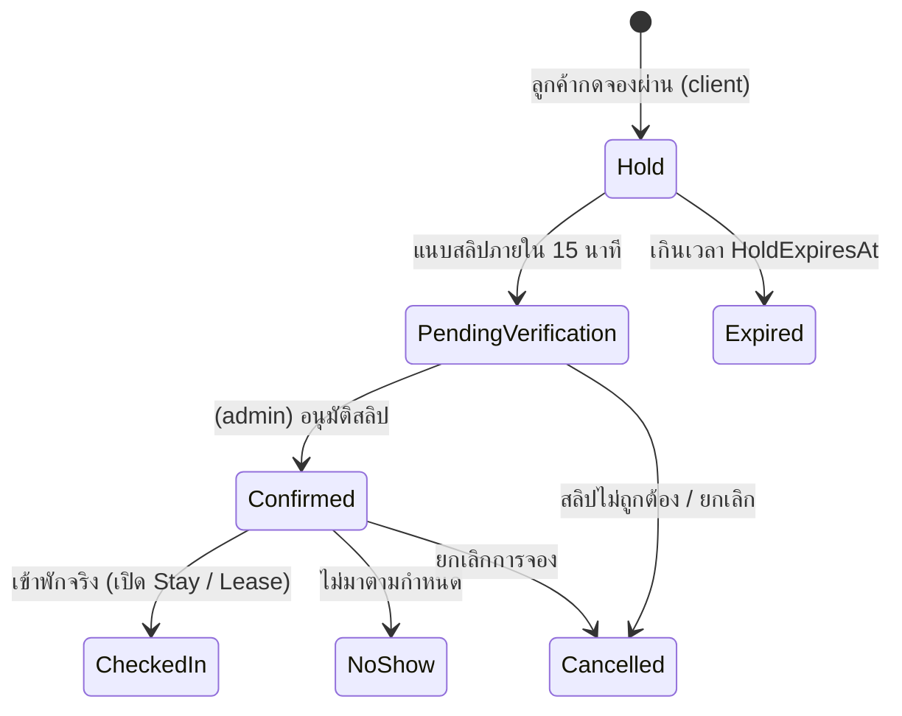

# Stay, Reservation & Lease Operational Flows — `tan-pms`

เอกสารนี้อธิบายกระบวนการทำงานหลัก (End-to-End Business Flows) สำหรับการจอง (`Reservation`), การเข้าพักรายชั่วโมงและรายวัน (`Stay` + `Folio`), สัญญาเช่ารายเดือน (`Lease`) และงานปฏิบัติการอาคาร (`HousekeepingTask`, `WorkOrder`, `Parcel`)

> คำศัพท์และสถานะทั้งหมดอ้างอิงจาก [CONTEXT.md](../../CONTEXT.md) และสูตรคำนวณราคา/ภาษีอ้างอิงจาก [pricing-meter-and-tax-rules.md](./pricing-meter-and-tax-rules.md)

---

## 1. กระบวนการจองห้องพักและล็อกโควตาชั่วคราว (`Reservation` & `Hold TTL`)

ระบบรองรับการจอง 2 รูปแบบเพื่อความยืดหยุ่นทั้งออนไลน์และหน้าเคาน์เตอร์:

### 1.1 การจองออนไลน์ผ่าน `client` (UnitType Quota + Hold TTL)
1. ลูกค้าในฝั่ง `client` เลือก `Property`, `StayMode` (`Hourly` หรือ `Daily`), ช่วงเวลาเข้าพัก และประเภทห้อง (`UnitType`)
2. ระบบตรวจสอบโควตาว่างของ `UnitType` ในช่วงเวลานั้น หากมีห้องว่างจะสร้างใบจองเลขที่ `{PROP}-RES-{YY}{MM}-{SEQ:4}` สถานะ `Hold` พร้อมตั้งเวลา `HoldExpiresAt = UtcNow + 15 minutes`
3. หน้าจอ `client` แสดงเวลานับถอยหลัง (Countdown) ให้ลูกค้าโอนเงินมัดจำและแนบสลิปผ่าน `useDeferredFileUpload`
4. **กรณีแนบสลิปทันเวลา:** สถานะเปลี่ยนเป็น `PendingVerification` (ล็อกโควตาต่อเนื่องจนกว่า `admin` จะตรวจสลิป) เมื่อ `admin` กดอนุมัติสลิป สถานะเปลี่ยนเป็น `Confirmed` พร้อมออกใบเสร็จ (`Receipt`)
5. **กรณีหมดเวลา `HoldExpiresAt` โดยไม่แนบสลิป:** สถานะเปลี่ยนเป็น `Expired` และระบบคืนโควตาห้องว่างให้ผู้อื่นจองต่อได้ทันทีโดยอัตโนมัติ

### 1.2 การจองระบุเลขห้อง (`Specific Unit Reservation`)
- ใช้สำหรับการจองหน้าเคาน์เตอร์โดย `admin` หรือการจองล่วงหน้าเพื่อทำสัญญารายเดือน (`Monthly`)
- ระบบล็อก `UnitId` และช่วงเวลาใน `tstzrange` ทันทีเพื่อป้องกันการจองซ้อน

---

## 2. กระบวนการเข้าพักรายชั่วโมงและรายวัน (`Hourly` & `Daily Stay` + `Folio`)

### 2.1 การเปิดห้องด่วนและเช็กอิน (`Quick Walk-in` / `Check-in`)
1. พนักงานฝั่ง `admin` เลือกห้องว่าง (`Unit.OccupancyStatus == Vacant`) ที่มีสถานะความสะอาด `Unit.ConditionStatus == Clean` (หากเป็น `Dirty` ระบบจะบล็อกด้วยรหัส `unit.not_clean` เว้นแต่ผู้มีสิทธิ์ `admin.stay.override_dirty_checkin` กดยืนยันพร้อมระบุเหตุผล)
2. บันทึกข้อมูลลูกค้าหลัก (`Customer`) และผู้พักอาศัย (`Occupant`) เพื่อใช้ส่งรายงาน ร.ร.4 และ ตม.30 (TM.30)
3. รับเงินมัดจำกุญแจ (บันทึกเข้า `DepositLedger` ผูกกับ `CashierShift` ที่ `Open`)
4. ระบบสร้างรายการ `Stay` (`{PROP}-STY-{YY}{MM}-{SEQ:4}`) สถานะ `Active` และเปิดกระเป๋าค่าใช้จ่าย `Folio` ประจำการเข้าพักนั้น โดยจองเวลาในฐานข้อมูลรวม `TurnaroundBufferMinutes` (เช่น +30 นาทีหลังเวลาออกสำหรับแม่บ้าน)

### 2.2 การจับเวลารายชั่วโมงและการเช็กเอาต์ (`Live Timer`, `Extend` & `Check-out`)
1. สำหรับโหมด `Hourly` หน้าจอ `admin` แสดงเวลาคงเหลือแบบสด เมื่อใกล้ครบเวลา (เช่น เหลือ 15 นาที) จะแสดงสถานะเตือน
2. ลูกค้าสามารถขอต่อเวลา (`Extend Stay`) โดยระบบตรวจสอบก่อนว่าไม่ชนกับรายการจองถัดไปของห้องนั้น หรือหากอยู่เกินเวลาผ่อนผัน (`GracePeriodMinutes`) ระบบจะคิดค่าชั่วโมงถัดไป (หรือปัดเป็นราคารายวันตาม `AutoCapToDailyRate`) เข้า `Folio` อัตโนมัติ
3. เมื่อทำรายการ `Check-out`:
   - สรุปยอดค่าห้อง + มินิบาร์ + ค่าปรับความเสียหายใน `Folio` ออกเป็น `Invoice` และ `Receipt`
   - คืนเงินมัดจำกุญแจหรือหักกลบค่าเสียหายใน `DepositLedger`
   - เปลี่ยน `Stay.Status = CheckedOut`, `Unit.OccupancyStatus = Vacant`, `Unit.ConditionStatus = Dirty` และสร้าง `HousekeepingTask` อัตโนมัติ

---

## 3. กระบวนการสัญญาเช่ารายเดือนและรอบบิล (`Monthly Lease` & `Batch Billing`)

1. **การทำสัญญาและส่งมอบห้อง (`Lease Creation` & `Move-in`):**
   - สร้างสัญญาเช่า `{PROP}-LSE-{YY}{MM}-{SEQ:4}` ระบุวันเริ่ม-สิ้นสุดสัญญา, ค่าเช่ารายเดือน, เงินประกันสัญญา และเลขมิเตอร์น้ำ-ไฟตั้งต้น (`InitialWaterReading`, `InitialElectricReading`)
   - บันทึกรายชื่อผู้พักร่วม (`Occupant`) และทะเบียนรถยนต์/รถจักรยานยนต์
   - เมื่อรับชำระเงินประกันสัญญาเข้า `DepositLedger` และส่งมอบห้องแล้ว สถานะเปลี่ยนเป็น `Active` (บล็อกตารางห้องไม่ให้เปิด `Hourly`/`Daily` ตลอดอายุสัญญา)
2. **การจดมิเตอร์และออกบิลรายเดือน (`Bulk Meter` & `Batch Invoice Run`):**
   - ทุกสิ้นรอบบิล พนักงานจดเลขมิเตอร์น้ำ-ไฟผ่านตาราง `Bulk Meter Reading` (`PM-07`)
   - ระบบสร้าง `Invoice` สถานะ `Draft` ยกตึก (รวมค่าเช่าห้อง + ค่าเช่าเฟอร์นิเจอร์/บริการ + ค่าน้ำ + ค่าไฟ แยกภาษีรายบรรทัด)
   - เมื่อ `admin` ตรวจสอบและกด `Issue` ระบบส่งแจ้งเตือนไปยังหน้า `client` ของผู้เช่าแต่ละห้องทันที
3. **การย้ายออกและคืนเงินประกัน (`Move-out Settlement`):**
   - เมื่อผู้เช่าแจ้งย้ายออก สถานะเปลี่ยนเป็น `MoveOutNotice`
   - วันย้ายออก พนักงานจดมิเตอร์ครั้งสุดท้ายและตรวจสภาพทรัพย์สินในห้อง (`UnitAsset`)
   - ระบบคำนวณยอดเงินประกันคงเหลือสุทธิใน `DepositLedger` (เงินประกันตั้งต้น หักค่าน้ำ-ไฟรอบสุดท้ายและค่าซ่อมแซม) เพื่อโอนคืนให้ผู้เช่า และเปลี่ยนสถานะสัญญาเป็น `MovedOut` พร้อมตั้งห้องเป็น `Dirty`

---

## 4. กระบวนการแม่บ้าน แจ้งซ่อม และรับพัสดุ (`Housekeeping`, `WorkOrder`, `Parcel`)

- **แม่บ้าน (`HousekeepingTask`):** ห้องที่เพิ่งเช็กเอาต์หรือย้ายออกจะขึ้นในกระดานแม่บ้าน (`Dirty` -> กดรับงานเป็น `Cleaning` -> ตรวจงาน `Inspecting` -> พร้อมขาย `Clean`)
- **แจ้งซ่อม (`WorkOrder`):** ผู้เช่าใน `client` หรือพนักงานใน `admin` เปิดใบงาน `{PROP}-WKO-{YY}{MM}-{SEQ:4}` พร้อมรูปถ่าย ช่างอัปเดตสถานะการซ่อม หากเป็นความเสียหายที่ผู้เช่าต้องรับผิดชอบ ระบบสามารถส่งรายการค่าซ่อมเข้า `Folio` หรือ `Invoice` รอบถัดไปได้ทันที
- **พัสดุ (`Parcel`):** พนักงานหน้าเคาน์เตอร์บันทึกรับพัสดุ `{PROP}-PCL-{YY}{MM}-{SEQ:4}` พร้อมถ่ายรูปกล่อง ระบบแจ้งเตือนไปยังผู้เช่าใน `client` และบันทึกหลักฐานเมื่อผู้เช่ามารับพัสดุแล้ว
