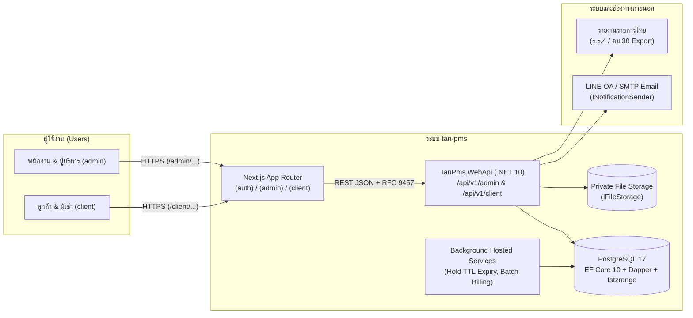

# System Context & High-Level Topology — `tan-pms`

เอกสารนี้แสดงบริบทของระบบ **`tan-pms`** ความสัมพันธ์ระหว่างผู้ใช้งานฝั่ง `admin` และ `client`, บริการภายใน และระบบภายนอก

> อ้างอิงกฎสถาปัตยกรรมหลักจาก [AGENTS.md](../../AGENTS.md) และคำศัพท์จาก [CONTEXT.md](../../CONTEXT.md)

---

## 1. แผนภาพบริบทของระบบ (System Context Diagram)

---

## 2. องค์ประกอบหลักของระบบ (Runtime Components)

| องค์ประกอบ | เทคโนโลยี | หน้าที่รับผิดชอบหลัก |
|---|---|---|
| **Web Application** | `Next.js (App Router)` + `TypeScript Strict` | ให้บริการหน้าจอ `(auth)`, `(admin)` สำหรับปฏิบัติการหน้าเคาน์เตอร์/ตึก และ `(client)` สำหรับผู้เช่า/ผู้จองออนไลน์ ภายใต้ระบบ **Ollama Minimal Design System** |
| **Backend API** | `.NET 10 (ASP.NET Core WebApi)` | บังคับใช้ `AdminScope` / `ClientScope`, ประมวลผล业务逻辑, รันเลขเอกสาร Atomic (`DocumentNumberService`), สร้างเอกสาร PDF (`QuestPDF`) และส่งออก OpenAPI Contract |
| **Background Worker** | `.NET HostedService` ใน `Infrastructure` | ปลดล็อกใบจองสถานะ `Hold` ที่หมดเวลา (`HoldExpiresAt < UtcNow`), แจ้งเตือนห้องรายชั่วโมงใกล้หมดเวลา และส่งคิวแจ้งเตือนใบแจ้งหนี้/พัสดุ |
| **Relational Database** | `PostgreSQL` | จัดเก็บข้อมูลธุรกรรมทั้งหมด พร้อมดัชนี `GiST` บน `tstzrange` เพื่อป้องกันการจองห้องซ้อนระดับฐานข้อมูล |
| **Private File Storage** | `IFileStorage` (Local/S3-compatible) | จัดเก็บรูปสลิปโอนเงิน, สำเนาบัตรประชาชน, สัญญาเช่า, รูปมิเตอร์, รูปแจ้งซ่อม และรูปพัสดุ แบบ Private (เปิดดูผ่าน Authorized Endpoint เท่านั้น) |
