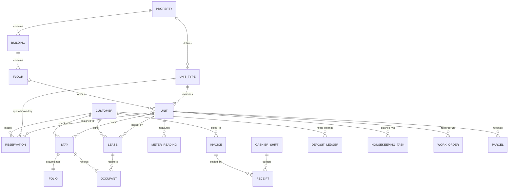

# Conceptual Data Model & Entity Relationships — `tan-pms`

เอกสารนี้แสดงแบบจำลองข้อมูลเชิงแนวคิด (Conceptual ER Diagram) และความสัมพันธ์ระหว่างเอนทิตีหลักทั้ง 20 คำศัพท์ของ **`tan-pms`**

> คำนิยามของทุกเอนทิตีอ้างอิงจาก [CONTEXT.md](../../CONTEXT.md) และมาตรฐานฐานข้อมูลอ้างอิงจาก [database-and-locking-standards.md](./database-and-locking-standards.md)

---

## 1. แผนภาพความสัมพันธ์ข้อมูลหลัก (Entity-Relationship Diagram)

---

## 2. สรุปกลุ่มตารางหลักตามขอบเขตธุรกิจ

1. **โครงสร้างสาขาและห้องพัก (`PM-02`):**
   - `properties` (`id`, `code`, `name`, `tax_branch_code`, `timezone`)
   - `buildings` (`id`, `property_id`, `code`, `name`)
   - `floors` (`id`, `building_id`, `floor_number`, `name`)
   - `unit_types` (`id`, `property_id`, `code`, `name`, `supported_stay_modes`, `base_capacity`)
   - `units` (`id`, `property_id`, `building_id`, `floor_id`, `unit_type_id`, `unit_number`, `occupancy_status`, `condition_status`)
2. **การจอง การเข้าพัก และสัญญารายเดือน (`PM-04`, `PM-05`, `PM-06`):**
   - `reservations` (`id`, `property_id`, `document_number`, `customer_id`, `unit_type_id`, `unit_id`, `stay_mode`, `reserved_period`, `status`, `hold_expires_at`)
   - `stays` (`id`, `property_id`, `document_number`, `reservation_id`, `customer_id`, `unit_id`, `stay_mode`, `occupied_period`, `status`)
   - `folios` & `folio_charges` (รายการค่าห้องรายชั่วโมง/รายวัน ค่าชั่วโมงเกินเวลา และมินิบาร์)
   - `leases` (`id`, `property_id`, `document_number`, `customer_id`, `unit_id`, `lease_period`, `monthly_rent_amount`, `security_deposit_amount`, `status`)
   - `occupants` & `tenant_vehicles` (ข้อมูลผู้พักร่วมสำหรับ ร.ร.4 / ตม.30 และป้ายทะเบียนรถ)
3. **มิเตอร์ ใบแจ้งหนี้ แคชเชียร์ และเงินประกัน (`PM-07`, `PM-08`):**
   - `meter_readings` (`id`, `property_id`, `unit_id`, `utility_type`, `billing_period`, `previous_reading`, `current_reading`, `usage_units`, `is_rollover_confirmed`, `photo_file_id`)
   - `invoices` & `invoice_lines` (แยก `tax_mode`, `vat_rate`, `vat_amount` รายบรรทัด)
   - `receipts` (`id`, `property_id`, `document_number`, `invoice_id`, `cashier_shift_id`, `payment_method`, `paid_amount`, `wht_amount`)
   - `cashier_shifts` (`id`, `property_id`, `document_number`, `cashier_user_id`, `opening_float_cash`, `expected_drawer_cash`, `actual_cash_counted`, `cash_variance`, `status`)
   - `deposit_ledgers` & `deposit_transactions` (`{PROP}-DEP-{YY}{MM}-{SEQ:4}`)
4. **แม่บ้าน แจ้งซ่อม และพัสดุ (`PM-09`):**
   - `housekeeping_tasks`, `work_orders` (`{PROP}-WKO-...`), `parcels` (`{PROP}-PCL-...`)
